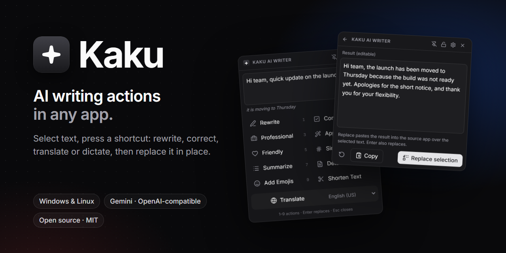
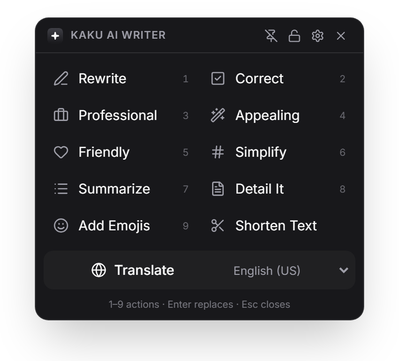
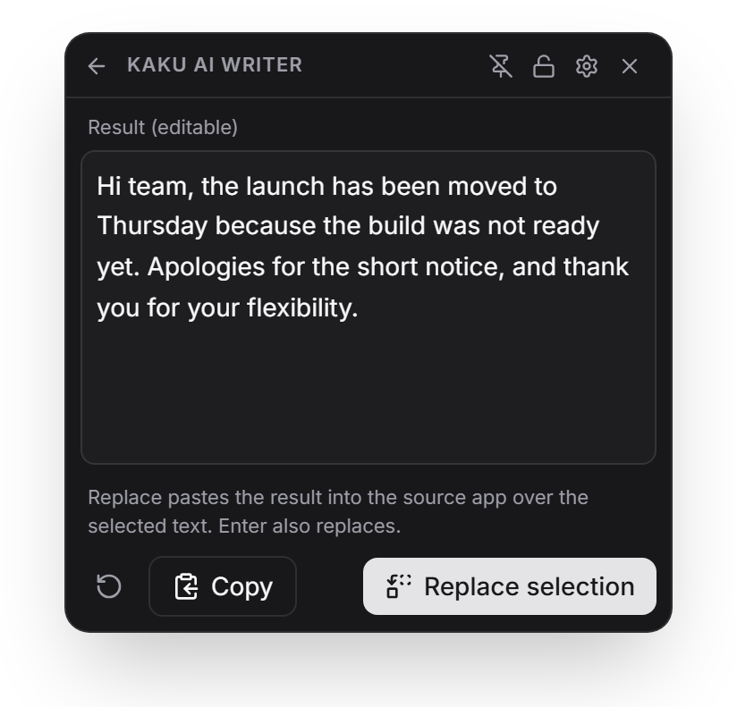
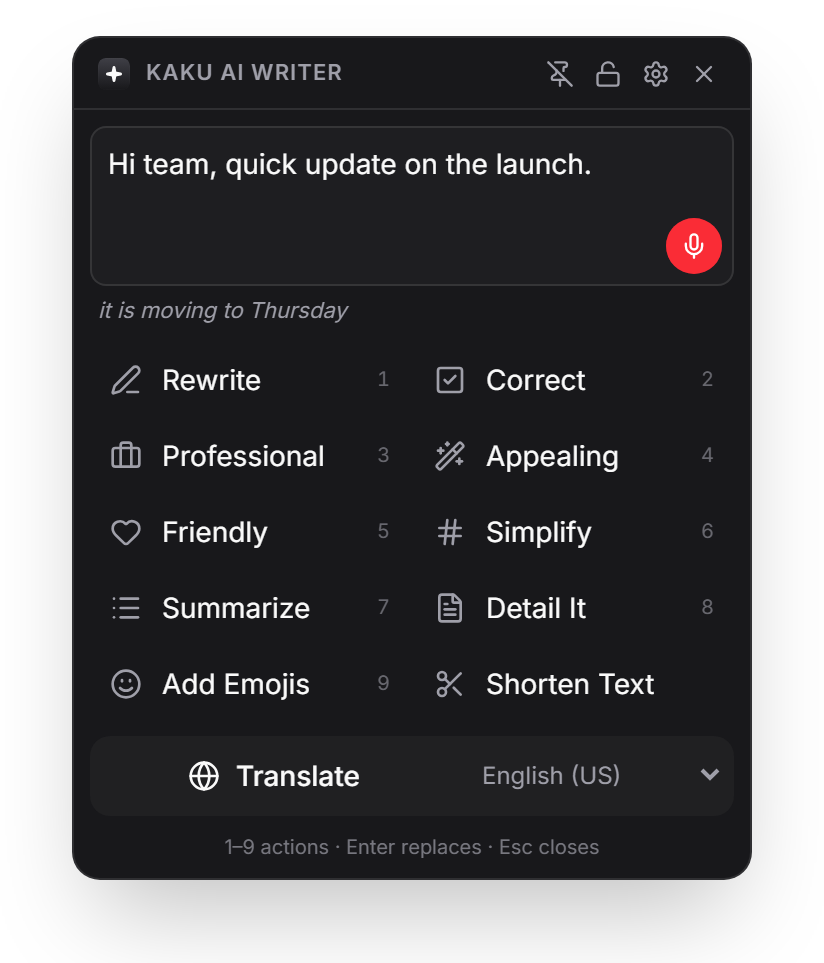
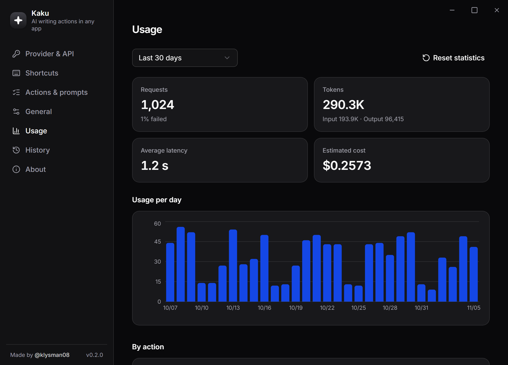
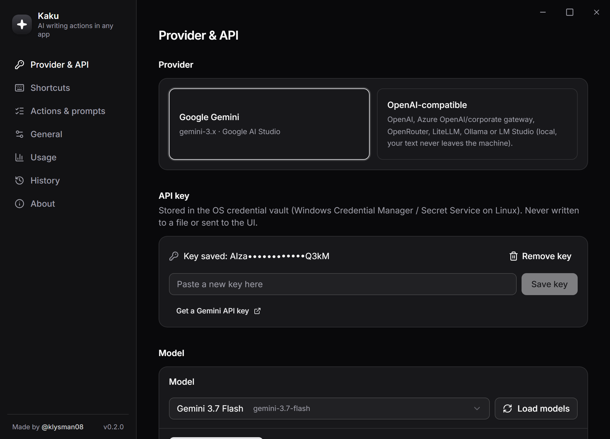
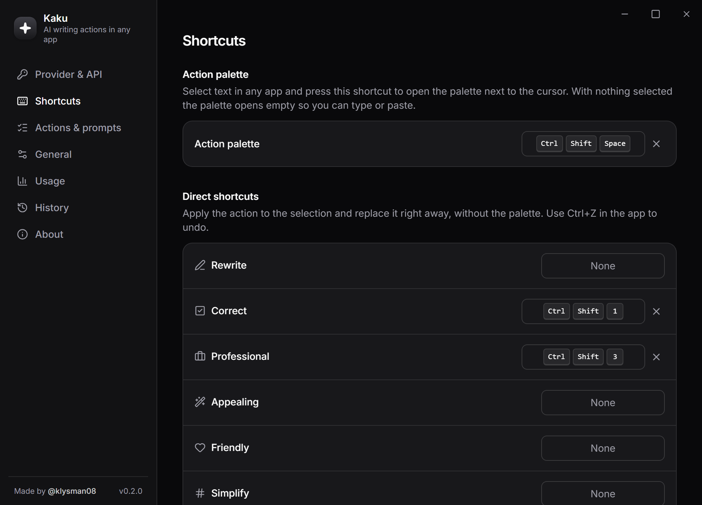
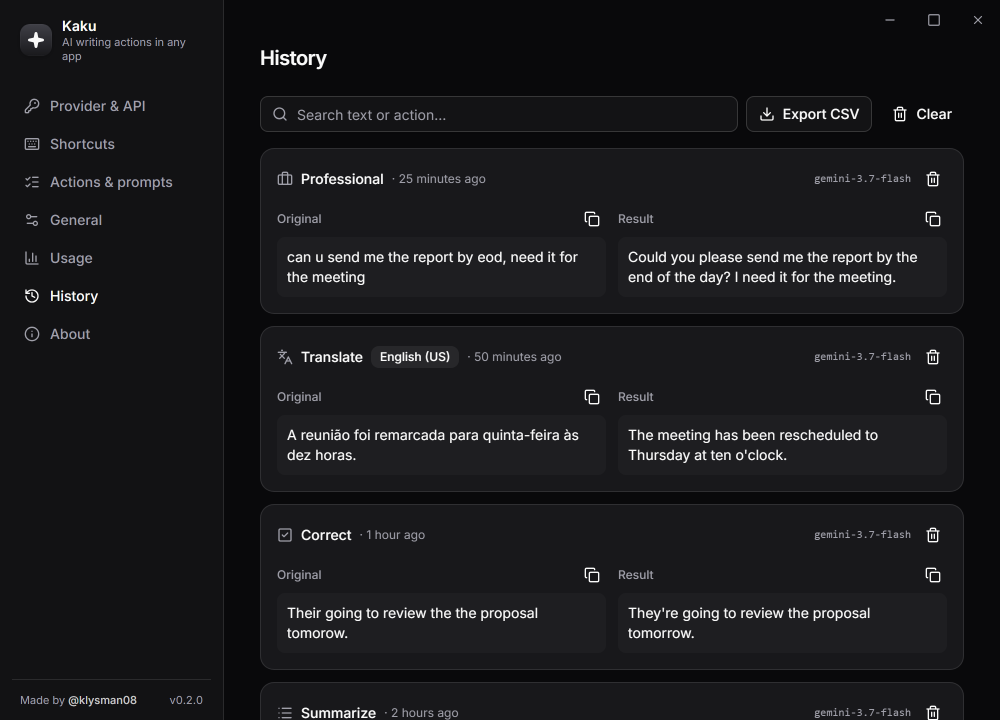

<div align="center">
  
  <p><strong>AI writing actions in any app.</strong> Select text anywhere — Outlook, Teams, Word, Slack, your IDE — press a shortcut, and rewrite, correct, translate or change its tone in place.</p>
  <p>
    <a href="README.pt-BR.md">Português</a> ·
    <a href="#install">Install</a> ·
    <a href="#shortcuts">Shortcuts</a> ·
    <a href="#privacy">Privacy</a> ·
    <a href="docs/RELEASING.md">Releasing</a>
  </p>
</div>

Kaku is the native desktop sibling of the [TextBetter](https://github.com/klysman08/TextBetter) browser extension, built with [Tauri 2](https://tauri.app) (Rust + React). It runs in the system tray and works system-wide on **Windows** and **Linux**.

## Screenshots

<table>
  <tr>
    <td align="center"><br /><sub>Action palette</sub></td>
    <td align="center"><br /><sub>Review, edit, replace</sub></td>
    <td align="center"><br /><sub>Voice dictation</sub></td>
  </tr>
</table>



<details>
<summary>More screenshots</summary>

| | |
|---|---|
| <br /><sub>Provider and API key</sub> | <br /><sub>Global shortcuts</sub> |
| <br /><sub>Local history</sub> | <br /><sub>Light theme</sub> |

</details>

## Features

- **11 actions** — Rewrite, Correct, Professional, Appealing, Friendly, Simplify, Summarize, Detail It, Add Emojis, Shorten Text and Translate (20 target languages).
- **Action palette** — press `Ctrl+Shift+Space` next to any selection; pick an action, review/edit the result, then **Replace** (or Copy).
- **Voice dictation** — a microphone button in the palette's text box. On Windows, pick live dictation with Windows speech recognition, or the AI provider (record, then transcribe with Gemini or an OpenAI-compatible `/audio/transcriptions` endpoint). Linux uses the AI provider.
- **Direct shortcuts** — bind any action to its own shortcut (defaults: `Ctrl+Shift+1` Correct, `Ctrl+Shift+2` Translate, `Ctrl+Shift+3` Professional). The selection is replaced immediately; undo with `Ctrl+Z` in the app.
- **Providers** — Google Gemini, or any **OpenAI-compatible** endpoint: OpenAI, Azure OpenAI / corporate gateways, OpenRouter, LiteLLM, and local **Ollama** / **LM Studio** (text never leaves your machine).
- **Usage dashboard** — requests, tokens, latency, failure rate, per-day chart, breakdown by action and model, estimated cost from your own per-model prices.
- **History** (optional, local) — search, copy, delete, CSV export, retention policy.
- **Custom prompts** per action, hide actions you don't use, light/dark theme, English/Portuguese UI.
- **Enterprise-friendly** — API keys in the OS credential vault, system or explicit proxy, OS certificate store (works behind TLS-inspecting proxies), per-user installer without admin rights, MSI for IT deployment, signed updates.

## Install

Download the latest release from the [Releases page](https://github.com/klysman08/Kaku/releases/latest):

| OS | File | Notes |
|---|---|---|
| Windows | `Kaku_x.y.z_x64-setup.exe` | Per-user install, no admin needed |
| Windows | `Kaku_x.y.z_x64_en-US.msi` | For IT deployment (Intune, GPO, SCCM) |
| Debian/Ubuntu | `kaku_x.y.z_amd64.deb` | |
| Fedora/openSUSE | `kaku-x.y.z-1.x86_64.rpm` | |
| Any Linux | `kaku_x.y.z_amd64.AppImage` | |

Verify a download: `sha256sum -c SHA256SUMS.txt` or `gh attestation verify <file> --repo klysman08/Kaku`.

Then open Kaku, go to **Provider & API**, paste your API key (e.g. from [Google AI Studio](https://aistudio.google.com/apikey)) and press **Test connection**.

## Shortcuts

| Shortcut | What it does |
|---|---|
| `Ctrl+Shift+Space` | Open the action palette next to the cursor (works with or without a selection) |
| `Ctrl+Shift+1` | Correct the selection in place |
| `Ctrl+Shift+2` | Translate the selection to your default language |
| `Ctrl+Shift+3` | Make the selection professional |

All shortcuts are configurable in **Settings › Shortcuts**; conflicts with other apps are detected. Inside the palette: `1`–`9` run actions, `Enter` replaces, `Esc` closes.

> Tip: avoid `Ctrl+Alt+<letter>` — on many keyboard layouts that is AltGr and would block typing characters.

### How replacing works

There is no cross-application "get selection" API, so Kaku does what you would do by hand: it sends `Ctrl+C`, reads the clipboard, calls the model, puts the result on the clipboard, sends `Ctrl+V`, and then **restores your previous clipboard text**. Temporary clipboard entries are excluded from Windows clipboard history and cloud sync.

### Command line

```
kaku --action <id> [--clipboard]   # run an action (review, translate, rewrite, ...)
kaku --popup                       # open the action palette
kaku --settings                    # open settings
```

`--clipboard` reads the text from the clipboard and writes the result back (no key simulation). Commands are forwarded to the running instance.

### Linux and Wayland

On X11 everything works out of the box. **Wayland** does not let apps register global shortcuts or simulate keystrokes, so create shortcuts in GNOME/KDE settings that run e.g. `kaku --action review --clipboard` or `kaku --popup`.

## Privacy

- No telemetry, no analytics, no account.
- Selected text is sent **only** to the provider you configure.
- Dictation audio goes to your AI provider, or to Microsoft when Windows dictation is chosen. It is never stored.
- API keys are stored in Windows Credential Manager / Secret Service, never in files or the UI.
- Usage metrics (no text) and the optional history live in a local SQLite database. Logs never contain your text.

See [PRIVACY.md](PRIVACY.md).

## Development

Requirements: Rust (stable), Node 22+, pnpm 10, and the [Tauri prerequisites](https://tauri.app/start/prerequisites/) for your OS (WebView2 + MSVC on Windows; `libwebkit2gtk-4.1-dev libappindicator3-dev librsvg2-dev libssl-dev libasound2-dev` on Linux).

```bash
pnpm install
pnpm app          # run in development (tauri dev)
pnpm check        # typecheck + vitest + rustfmt + clippy + cargo test
pnpm tauri build  # build installers locally
```

The UI also runs in a plain browser on sample data: start `pnpm dev` and open `http://localhost:1420/?mock&tab=dashboard` (or `/popup.html?mock&scene=result`). With the dev server running, `node scripts/screenshots.mjs` regenerates every image in `docs/images/`, including the social preview, using headless Edge or Chrome.

Project layout:

```
src/                 React UI (one Vite entry per window)
  settings/          settings window: provider, shortcuts, actions, general, usage, history, about
  popup/             action palette
  toast/             progress indicator for direct shortcuts
  lib/ipc.ts         typed bindings to the Rust commands
  dev/mock.ts        sample backend for browser previews and screenshots (dev only)
src-tauri/src/
  actions.rs         actions and their prompts (single source of truth)
  ai/                Gemini and OpenAI-compatible clients
  selection.rs       copy selection / paste result / restore clipboard
  speech/            dictation: Windows speech recognition, microphone recorder
  shortcuts.rs       global shortcuts
  db.rs              SQLite usage + history
  secrets.rs         OS credential vault
scripts/             release, Windows signing hooks, screenshots
```

## Releasing

`pnpm release patch` bumps the version, tags `vX.Y.Z` and pushes; GitHub Actions builds, signs (when configured) and drafts the release. Details, secrets and code-signing options: [docs/RELEASING.md](docs/RELEASING.md).

## License

[MIT](LICENSE)
