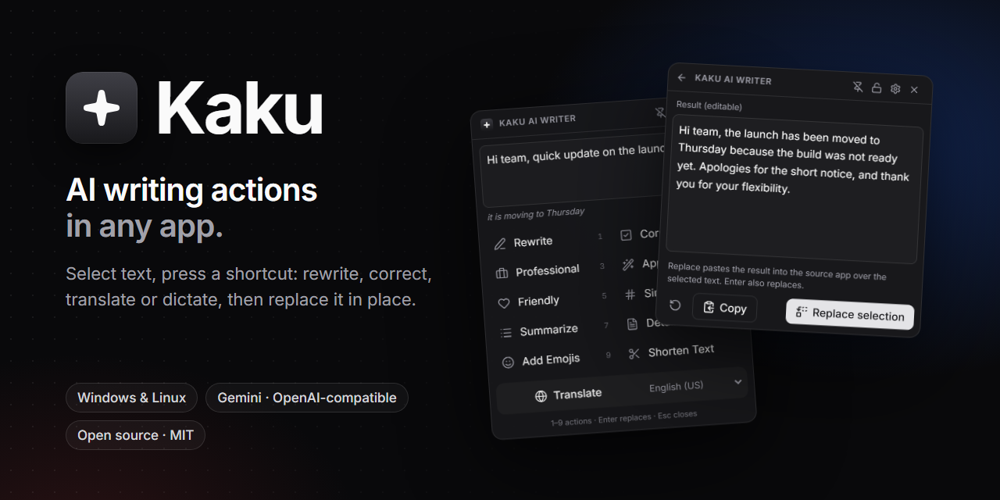
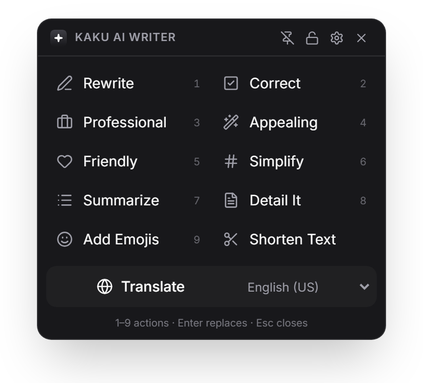
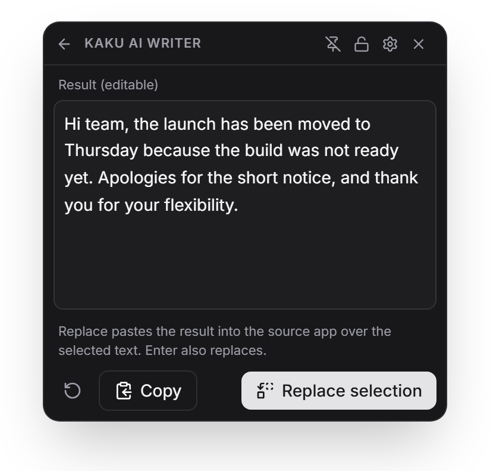
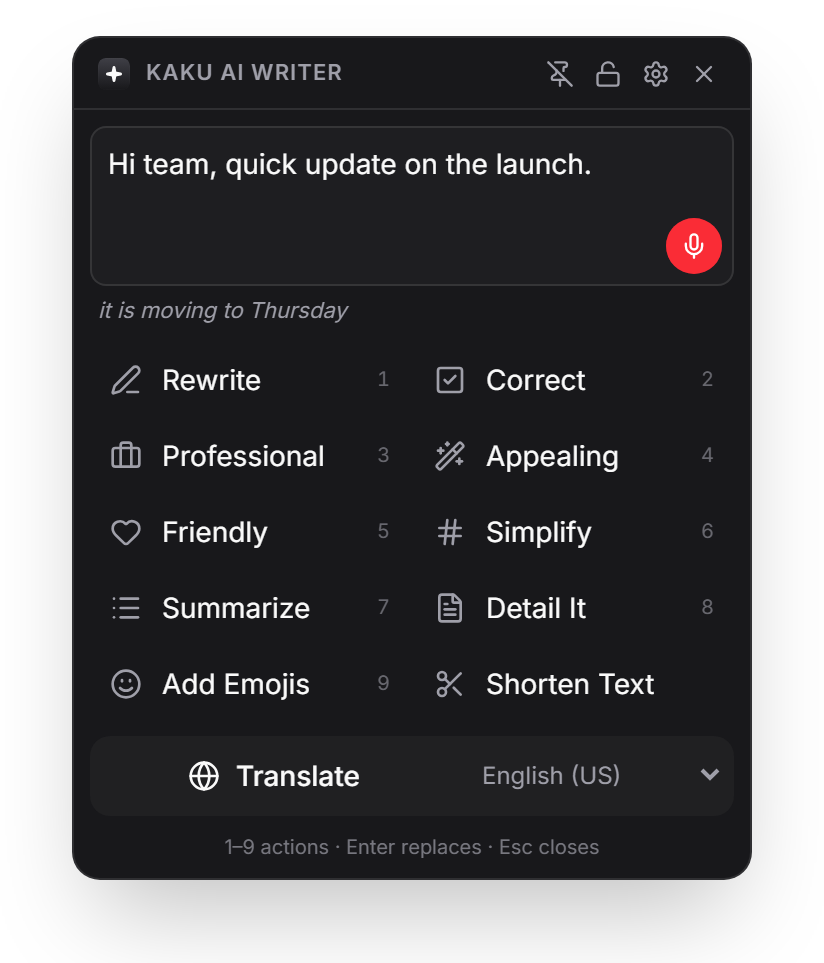
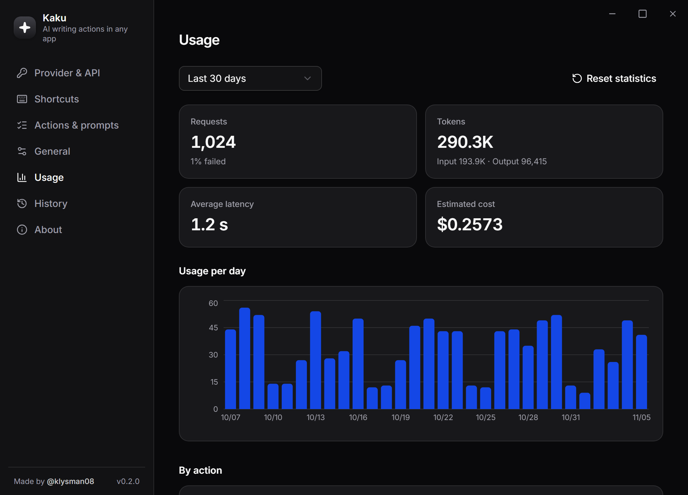
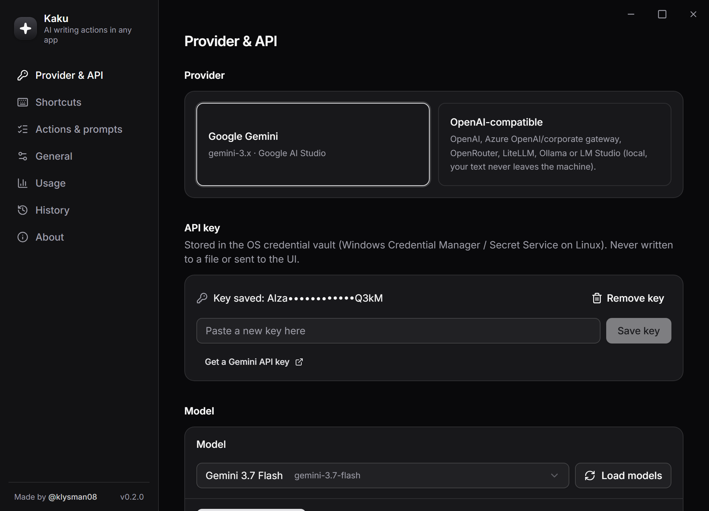
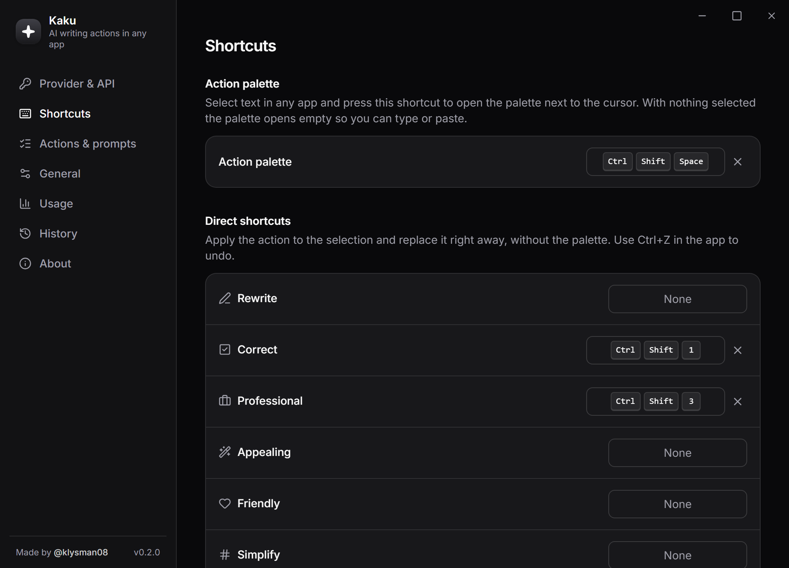
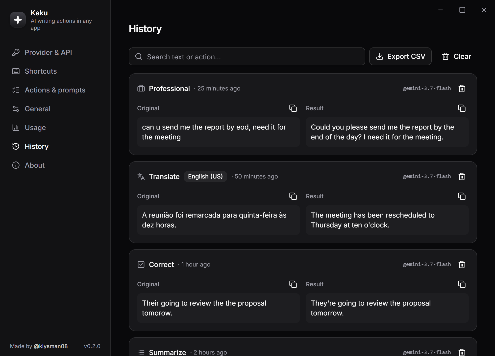
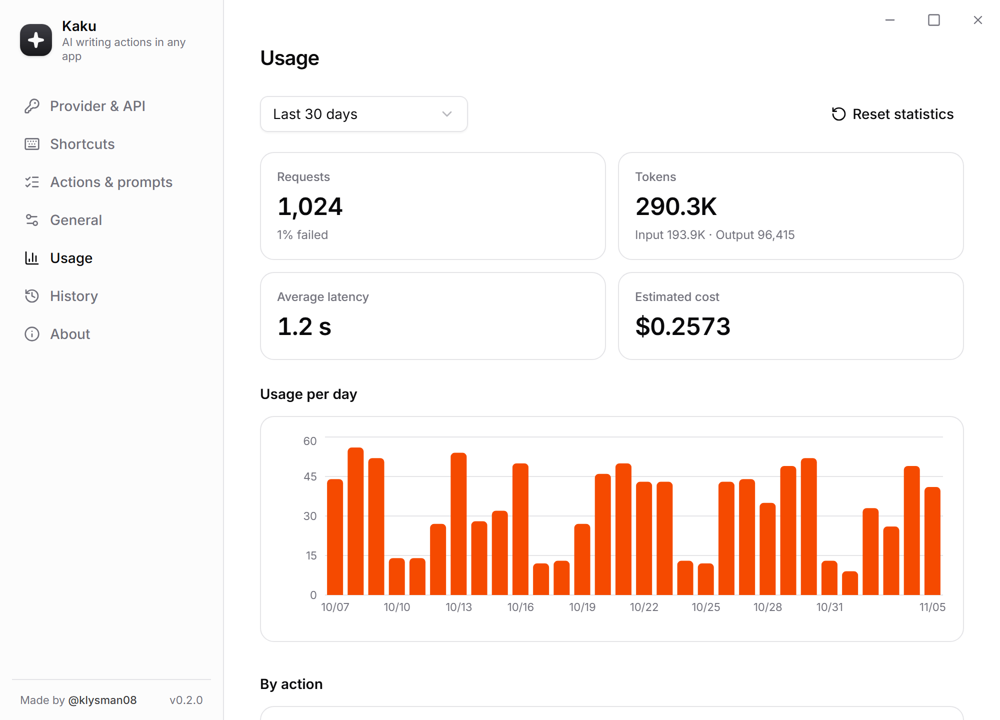

<div align="center">
  
  <p><strong>Ações de escrita com IA em qualquer aplicativo.</strong> Selecione um texto em qualquer lugar — Outlook, Teams, Word, Slack, sua IDE — aperte um atalho e reescreva, corrija, traduza ou mude o tom ali mesmo.</p>
  <p><a href="README.md">English</a></p>
</div>

O Kaku é a versão desktop nativa da extensão [TextBetter](https://github.com/klysman08/TextBetter), feita com [Tauri 2](https://tauri.app) (Rust + React). Fica na bandeja do sistema e funciona em todo o **Windows** e **Linux**.

## Capturas de tela

Interface mostrada em inglês; o app também está em português.

<table>
  <tr>
    <td align="center"><br /><sub>Paleta de ações</sub></td>
    <td align="center"><br /><sub>Revise, edite, substitua</sub></td>
    <td align="center"><br /><sub>Ditado por voz</sub></td>
  </tr>
</table>



<details>
<summary>Mais capturas</summary>

| | |
|---|---|
| <br /><sub>Provedor e API key</sub> | <br /><sub>Atalhos globais</sub> |
| <br /><sub>Histórico local</sub> | <br /><sub>Tema claro</sub> |

</details>

## Recursos

- **11 ações**: Reescrever, Corrigir, Profissional, Atraente, Amigável, Simplificar, Resumir, Detalhar, Adicionar emojis, Encurtar e Traduzir (20 idiomas).
- **Paleta de ações**: `Ctrl+Shift+Space` ao lado de qualquer seleção; escolha a ação, revise/edite o resultado e clique em **Substituir** (ou Copiar).
- **Ditado por voz**: botão de microfone na caixa de texto da paleta. No Windows, escolha o ditado ao vivo do reconhecimento de fala do Windows, o ditado do Windows (painel do Win+H) ou o provedor de IA (grava e transcreve com o Gemini ou um endpoint `/audio/transcriptions` compatível com OpenAI). No Linux, usa o provedor de IA.
- **Atalhos diretos** por ação (padrão: `Ctrl+Shift+1` Corrigir, `Ctrl+Shift+2` Traduzir, `Ctrl+Shift+3` Profissional). O texto é substituído na hora; desfaça com `Ctrl+Z` no próprio aplicativo.
- **Provedores**: Google Gemini ou qualquer endpoint **compatível com OpenAI** — OpenAI, Azure OpenAI / gateway corporativo, OpenRouter, LiteLLM e **Ollama** / **LM Studio** locais (o texto não sai do computador).
- **Dashboard de uso**: requisições, tokens, latência, taxa de falhas, gráfico diário, por ação e por modelo, custo estimado.
- **Histórico** opcional e local, com busca, exportação CSV e retenção configurável.
- **Prompts personalizados**, ações ocultáveis, tema claro/escuro, interface em português e inglês.
- **Pronto para empresa**: chaves no cofre do sistema, proxy do sistema ou explícito, certificados do Windows (funciona atrás de proxy com inspeção TLS), instalador por usuário sem admin, MSI para o TI, atualizações assinadas.

## Instalação

Baixe em [Releases](https://github.com/klysman08/Kaku/releases/latest): `*_x64-setup.exe` (por usuário, sem admin), `*.msi` (implantação pelo TI), `.deb`, `.rpm` ou `.AppImage`. Confira com `SHA256SUMS.txt` ou `gh attestation verify <arquivo> --repo klysman08/Kaku`.

Abra o Kaku › **Provedor e API**, cole sua API key (ex.: [Google AI Studio](https://aistudio.google.com/apikey)) e clique em **Testar conexão**.

## Como a substituição funciona

Não existe API para ler a seleção de outros programas, então o Kaku faz o que você faria: envia `Ctrl+C`, lê a área de transferência, chama o modelo, coloca o resultado na área de transferência, envia `Ctrl+V` e **restaura o texto que estava antes**. As entradas temporárias ficam fora do histórico/sincronização da área de transferência do Windows.

## Linha de comando e Wayland

```
kaku --action <id> [--clipboard]
kaku --popup
kaku --settings
```

No **Wayland** não há atalhos globais nem simulação de teclado: crie atalhos no GNOME/KDE que executem `kaku --action review --clipboard` ou `kaku --popup`.

## Privacidade

Sem telemetria e sem conta. O texto vai só para o provedor configurado. O áudio do ditado vai para o seu provedor de IA, ou para a Microsoft quando o ditado do Windows é escolhido, e nunca é guardado. Chaves ficam no Gerenciador de Credenciais do Windows / Secret Service. Métricas (sem texto) e histórico opcional ficam num SQLite local. Logs nunca contêm seu texto. Veja [PRIVACY.md](PRIVACY.md).

## Desenvolvimento e release

```bash
pnpm install
pnpm app            # tauri dev
pnpm check          # typecheck + vitest + rustfmt + clippy + cargo test
pnpm release patch  # versão + tag + push → GitHub Actions gera o release
```

Guia completo de release, secrets e assinatura: [docs/RELEASING.md](docs/RELEASING.md).

## Licença

[MIT](LICENSE)
